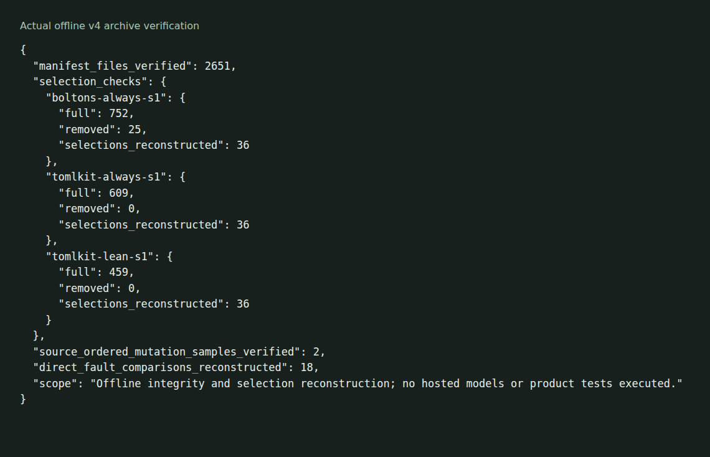

# Test-suite pruning and scheduling experiment

Code and saved evaluation material for a test-maintenance method. The manuscript is being prepared for SANER 2027; publication or acceptance is not claimed.

The current evidence is **review-supplement-v4.tar.gz** in the [versioned evaluation release](https://github.com/olegpustovit/agent-test-pruning/releases/tag/saner-2027-evaluation-2026-10-19). Download the v4 asset for the exact evaluated implementation and inputs. The release tag and files on the repository branch represent earlier development states.



The [capture notes](docs/demo/README.md) distinguish archive verification from rerunning the product experiments.

## Current evaluation

The method separates permanent removal from less frequent execution. Removal uses structured assessment to nominate candidates, contextual review to identify retained replacements, an independent review veto, protection and code-reach checks, and unchanged-source execution validation. A separate public-project case evaluates execution-frequency allocation using risk reach and CI history.

The v4 archive contains public and generated source snapshots with upstream licenses, assessment and decision records, frozen selections, raw mutation executions, repeated local timings, historical failure traces and verification scripts. The archive includes no confidential client/employer source or results and no venue-corpus full texts.

## Verification

Extract v4, enter `artifact-supplement-v4`, and run:

```sh
uv run verify_public_evidence.py
```

This offline check validates the manifest, reconstructs removal selections and execution order, verifies source-ordered mutation samples and reconstructs direct fault comparisons. It does not call models or execute the tested products. The archive README explains how to reproduce product executions in isolated copies and documents the limits of the measurements.

v4 SHA-256: `2e30853dfc7a4f29933d7bceff933e6c5e35e8b5a5b605a3633086be4c1de9cf`.

## Earlier material

The v3 archive and branch files remain as development provenance. Earlier mutation scores are not certified for reuse because an interruption-attribution defect was identified. The revised manuscript uses the checked experiments in v4. Earlier Python replay and test-generation configuration records remain useful provenance, but should not be confused with the new selection and fault-outcome records.

Python tools use inline dependency metadata and run through `uv run`. Repeating model-assisted assessment requires the respective model service credentials; verifying the saved decisions and results does not.
